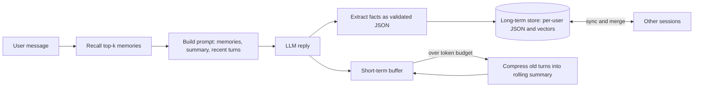
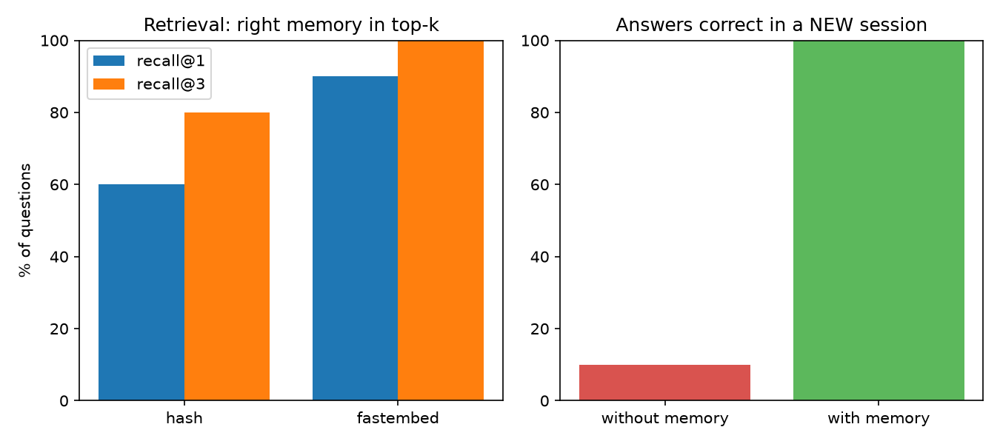

# Memory-Enabled Conversational Agent

An LLM agent that remembers users across conversations: a short-term buffer with context compression, long-term vector recall with relevance scoring, and cross-session sync.

## Problem

LLMs forget everything when a session ends, and stuffing the full chat history into every prompt is costly and noisy. This project builds a memory layer that decides what to keep, finds it again by meaning, and keeps the prompt small.

## Architecture



| Component | File | What it does |
|---|---|---|
| Short-term buffer | `src/short_term.py` | Keeps recent turns verbatim; folds older turns into a rolling summary when over a token budget |
| Long-term memory | `src/memory.py` | Per-user vector store persisted as JSON; recall, dedupe, forget, merge-based sync |
| Embeddings | `src/embeddings.py` | `HashEmbedder` (no dependencies, baseline) and `FastEmbedder` (local ONNX semantic model) |
| Fact extraction | `src/extractor.py` | LLM extracts durable facts into a Pydantic schema, with retry on validation errors |
| Agent | `src/agent.py` | Ties recall, prompting, extraction, compression and session summaries together |
| CLI | `src/cli.py` | Interactive chat with `/memories`, `/forget`, `/new`, `/exit` |
| LLM client | `src/llm.py` | Groq through its OpenAI-compatible endpoint |

## How memory works

**Relevance scoring.** Each stored memory is ranked against the current message:

```
score = 0.70 * similarity + 0.15 * recency + 0.15 * importance
```

- `similarity`: cosine similarity between the message and the memory embedding.
- `recency`: halves every 30 days since the memory was last updated.
- `importance`: 1 to 5 as judged by the extractor (for example, an allergy outranks a hobby), rescaled to 0 to 1.
- Memories below a minimum similarity (`MIN_SIM`) are never recalled.

**Deduplication.** A new fact that is at least 0.85 similar to an existing memory updates it instead of creating a duplicate.

**Conflicts.** If facts change over time, both are kept. The prompt shows each memory's saved date and tells the model to trust the most recent one.

**Cross-session sync.** Several sessions can use the same user file. Before every read and write the agent reloads the file and merges per memory (the newer `updated_at` wins). Deletions are stored as tombstones so a deleted memory cannot be resurrected by another session's older copy. Writes are atomic (temp file, then replace).

**Context compression.** When the recent-turn buffer exceeds its token budget, everything except the last 4 messages is merged with the previous summary into one new summary. If the summarizing call fails, a crude fallback still shrinks the buffer.

**Session summaries.** When a session ends, the conversation is condensed into one low-importance long-term memory.

## Results

Model: `openai/gpt-oss-20b` on Groq. Embedders: hash baseline vs `BAAI/bge-small-en-v1.5` (fastembed).
Test set: 10 facts, 10 differently worded questions, 8 distractor memories, one fictional persona.

### Retrieval (is the right memory in the top-k of 18 memories?)

| Embedder | recall@1 | recall@3 | MRR |
|---|---|---|---|
| Hash (baseline) | 60% | 80% | 0.70 |
| FastEmbed | 90% | 100% | 0.95 |

Semantic embeddings fix the misses of the hash baseline on paraphrased questions such as asking about "dietary restrictions" when the stored fact says "vegetarian".

### End to end (facts told in session 1, each question asked in a fresh session)

| Setup | Correct answers |
|---|---|
| Without memory | 1/10 by automated check, 0/10 after manual review |
| With memory | 10/10 by automated check |

The single no-memory hit was a keyword false positive: the reply was generic coffee guidance and did not state the user's preference, so the true baseline is 0/10. The agent stored 11 memories for the 10 facts; the extra memory was not investigated.

### Context compression

With a 250-token buffer budget, the buffer was compressed 7 times (peak 1,726 tokens, 503 after compression) and a detail planted in the first message was still answered correctly at the end. The budget is soft: the last 4 messages are never compressed, so long replies can exceed it.



## How to run

```powershell
git clone https://github.com/Anupirani/memory_agent.git
cd memory-agent
python -m venv .venv
.\.venv\Scripts\Activate.ps1
pip install -r requirements.txt
```

Create a `.env` file (never commit it) with a free Groq key from console.groq.com:

```
LLM_API_KEY=your-groq-key
LLM_BASE_URL=https://api.groq.com/openai/v1
LLM_MODEL=openai/gpt-oss-20b
LLM_JSON_MODE=1
EMBEDDER=hash
MIN_SIM=0.20
```

Model names change over time; list the ones your key can use if you get a 404.
For semantic search, run `pip install fastembed` and set `EMBEDDER=fastembed` (tune `MIN_SIM` by watching the similarity values the CLI prints).

```powershell
python -m pytest -v                 # 24 tests, no API key needed
python -m src.cli --user demo       # chat; run it again later to see memory persist
python -m evals.run_eval --skip-llm # retrieval comparison, no API calls
python -m evals.run_eval            # full evaluation (about 70 LLM calls)
```

CLI commands: `/memories` lists stored memories, `/forget <id>` deletes one, `/new` ends the session while keeping long-term memory, `/exit` saves a session summary and quits. Run two terminals with the same `--user` to see cross-session sync.

## Project structure

```
src/        llm.py, embeddings.py, memory.py, short_term.py, extractor.py, agent.py, cli.py
tests/      test_memory.py, test_short_term.py, test_extractor.py, test_agent.py (fake LLM, no network)
evals/      run_eval.py, results.json, results.png
data/       eval_set.json (data/users/ holds real memory files and is git-ignored)
```

## Limitations

- **Small evaluation.** One fictional persona, 10 questions and 8 distractors; results demonstrate the approach and are not a benchmark.
- **Keyword-based answer checking.** It can credit lucky matches (one false positive was found and corrected manually) or miss correct paraphrases. An LLM judge would be stricter.
- **One model, one provider.** Everything ran on Groq with a single model.
- **Soft compression budget.** The last 4 messages are never compressed, so the buffer can exceed its budget.
- **Estimated tokens.** Token counts use a rough 4-characters-per-token rule.
- **Sync is merge-based, not locked.** Two sessions writing at the exact same instant can still lose one update.
- **Extraction cost.** Each message of 4 or more words triggers an extra LLM call.
- **Privacy.** Memories are stored as plain JSON on disk. A real product would need encryption, user consent and a delete-everything command.

## Possible extensions

- LLM-as-judge scoring and a larger, multi-persona evaluation set
- Include the previous assistant turn in the recall query to resolve pronouns
- Hard token budget for the buffer, with truncation of long replies
- Memory consolidation: merging related facts and expiring stale ones
- A vector database (for example Chroma or FAISS) for large memory stores
